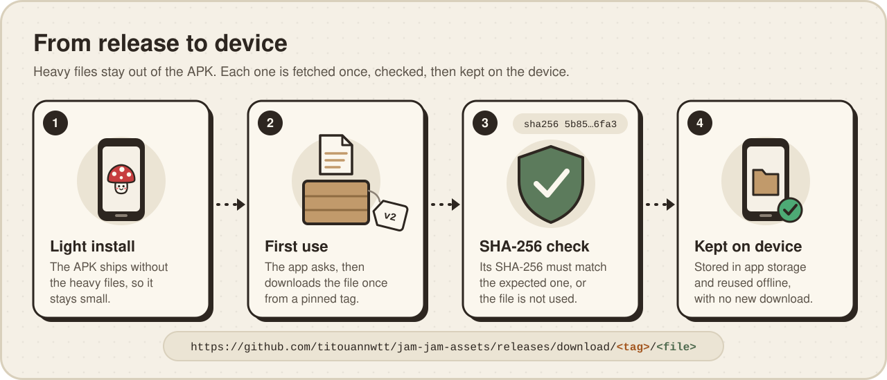
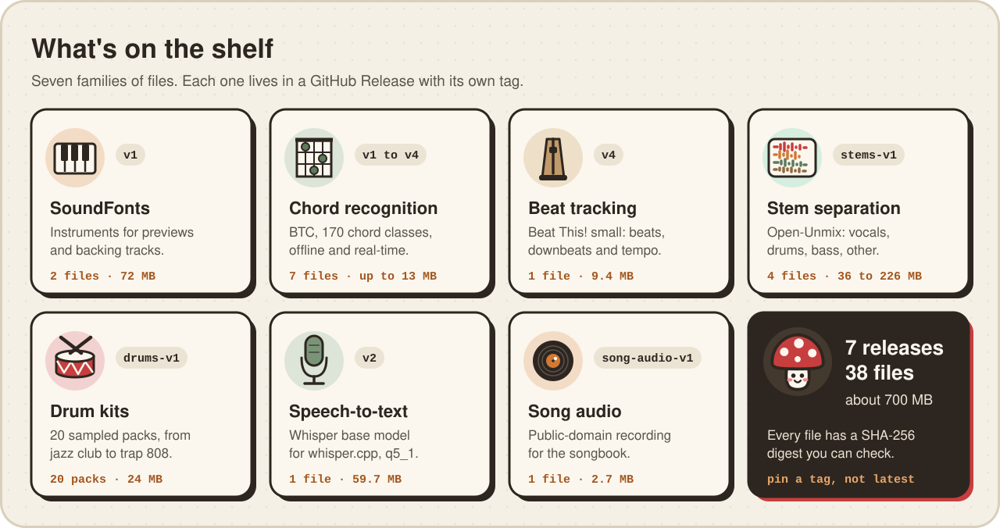

<p align="center">
  
</p>

<p align="center">
  <a href="#whats-inside"><b>What's inside</b></a> ·
  <a href="#download-and-verify"><b>Download and verify</b></a> ·
  <a href="#publish-a-new-version"><b>Publish a new version</b></a> ·
  <a href="#licenses-and-credits"><b>Licenses and credits</b></a>
</p>

## What is this?

[Jam Jam](https://jam-jam.org) is a free chord detector and personal songbook for musicians. This repository holds the heavy files the app needs (SoundFonts, AI models, drum kits, audio) as GitHub Release assets, so the app can download each one the first time it is needed instead of carrying it in the install.

There is no app code here: only the files, their release notes and their credits.

## How the app gets a file

<p align="center"></p>

- **One tag, one set of files.** The app asks for an exact URL, for example `https://github.com/titouannwtt/jam-jam-assets/releases/download/v1/MuseScore_General.sf3`. A new version of a file goes into a new release, so older app versions keep working.
- **Every file is checked.** The app knows the expected size and SHA-256 of each file, and compares the SHA-256 after the download. A file that does not match is reported as an error and never used.
- **Downloaded once.** Files are stored in the app's own storage and reused offline.

## What's inside

<p align="center"></p>

| Release | Published | What it adds | Files | Total |
|---|---|---|--:|--:|
| [`v1`](#v1-initial-audio-assets) | 2026-05-29 | Two SoundFonts and the first chord models | 5 | 91.2&nbsp;MB |
| [`v2`](#v2-retrained-chord-models) | 2026-07-23 | Retrained chord models, speech-to-text model | 3 | 85.7&nbsp;MB |
| [`v3`](#v3-chord-model-candidate-development-channel) | 2026-07-28 | Candidate chord models for the development channel | 2 | 26.0&nbsp;MB |
| [`stems-v1`](#stems-v1-stem-separation) | 2026-07-28 | Open-Unmix stem separation, four variants | 4 | 447.8&nbsp;MB |
| [`v4`](#v4-beat-tracking) | 2026-07-29 | Beat This! beat tracking model | 2 | 22.4&nbsp;MB |
| [`drums-v1`](#drums-v1-drum-kits) | 2026-08-09 | 20 sampled drum and percussion packs, with credits | 21 | 24.3&nbsp;MB |
| [`song-audio-v1`](#song-audio-v1-songbook-audio) | 2026-09-01 | Public-domain recording for the songbook | 1 | 2.7&nbsp;MB |

Sizes use 1 MB = 1,000,000 bytes. Exact byte counts are in `gh release view <tag> -R titouannwtt/jam-jam-assets --json assets`.

### `v1`: initial audio assets

First release. Its files are stable and the tag will not be rewritten.

| File | Size | What it is | License |
|---|--:|---|---|
| `MuseScore_General.sf3` | 39.90&nbsp;MB | General MIDI SoundFont: instrument sounds for chord previews and backing tracks. | [MIT](#licenses-and-credits) |
| `GeneralUser-GS.sf2` | 32.32&nbsp;MB | General MIDI SoundFont GeneralUser GS 2.0.3 by S. Christian Collins, identical to the upstream file. | [GeneralUser GS License 2.0](#licenses-and-credits) |
| `btc_model_170_ft.onnx` | 12.95&nbsp;MB | Chord recognition, 170 chord classes, bidirectional: analyses a whole song offline. | [see upstream](#licenses-and-credits) |
| `btc_model_170_causal.onnx` | 6.04&nbsp;MB | Causal variant of the same model: real-time detection with no look-ahead delay. | [see upstream](#licenses-and-credits) |
| `SHA256SUMS.txt` | 353&nbsp;B | SHA-256 of the four files above. | |

### `v2`: retrained chord models

The chord models retrained on a validated corpus of 952 real songs, with transposition augmentation and weight averaging. Weighted chord symbol recall (WCSR) goes from 62.6 % to 63.4 %, sevenths and diminished chords gain 5 to 11 points, and triads are unchanged.

| File | Size | What it is | License |
|---|--:|---|---|
| `btc_model_170_ft.onnx` | 13.04&nbsp;MB | Offline (bidirectional) chord model, fp32. | [see upstream](#licenses-and-credits) |
| `btc_model_170_causal.onnx` | 12.94&nbsp;MB | Real-time (causal) chord model, now full size instead of the smaller v1 variant. | [see upstream](#licenses-and-credits) |
| `ggml-base-q5_1.bin` | 59.71&nbsp;MB | Whisper `base` speech-to-text model, 5-bit quantized for whisper.cpp. Identical to the upstream file (same SHA-256). | [MIT](#licenses-and-credits) |

### `v3`: chord model candidate, development channel

A candidate chord model (`soup_t2_04`, a weighted average of two trained models), from the training cycle that used 401 human-written chord sheets. On the held-out reference set, against the `v2` model: WCSR 68.0 to 68.5, major -0.4 and minor -0.6 points, diminished 11.8 to 23.5, diminished seventh 55.7 to 58.6, richer chords +4.7 points on average, and no regression larger than 1 point. It ships to the development channel only and does not replace `v2`, which stable builds use.

| File | Size | What it is | License |
|---|--:|---|---|
| `btc_model_170_ft.onnx` | 13.04&nbsp;MB | Offline bidirectional model, dynamic time axis. | [see upstream](#licenses-and-credits) |
| `btc_model_170_causal.onnx` | 12.94&nbsp;MB | Causal real-time model, window of 54 frames. | [see upstream](#licenses-and-credits) |

Both are ONNX opset 14 with 170 classes, in the same format as `v2`. Input normalisation: mean -2.2280, standard deviation 1.7191.

### `v4`: beat tracking

| File | Size | What it is | License |
|---|--:|---|---|
| `beat_this_small.onnx` | 9.40&nbsp;MB | Beat This! `small`: beat and downbeat tracking, for tempo and bars. | [MIT](#licenses-and-credits) |
| `btc_model_170_ft.onnx` | 13.04&nbsp;MB | Offline chord model in the `v2` format. A different build from `v2` and `v3` (see its SHA-256 below). | [see upstream](#licenses-and-credits) |

### `stems-v1`: stem separation

[Open-Unmix](https://github.com/sigsep/open-unmix-pytorch) exported to ONNX to split a song into four stems (vocals, drums, bass, other) on the device. The model works spectrogram to spectrogram: the STFT and inverse STFT run outside it. Fixed window of 512 frames, 44.1 kHz stereo, `n_fft` 4096, hop 1024, Hann window. The stems feed a weighted remix that makes chord detection more reliable; they are not meant for listening.

| File | Size | What it is | License |
|---|--:|---|---|
| `umxl_stems.fp16.onnx` | 226.27&nbsp;MB | `umxl` weights, fp16. Recommended: about 0.2 % error against fp32. | [CC BY-NC-SA 4.0 (weights)](#licenses-and-credits) |
| `umxl_stems.int8.onnx` | 113.93&nbsp;MB | `umxl` weights, int8. Lighter, but vocals and bass degrade (about 30 to 42 %). | [CC BY-NC-SA 4.0 (weights)](#licenses-and-credits) |
| `umxhq_stems.fp16.onnx` | 71.32&nbsp;MB | `umxhq` weights, fp16. | [MIT](#licenses-and-credits) |
| `umxhq_stems.int8.onnx` | 36.22&nbsp;MB | `umxhq` weights, int8. | [MIT](#licenses-and-credits) |

The release notes describe the `umxl` export; the `umxhq` files follow the same naming.

### `drums-v1`: drum kits

One SoundFont per pack: bank 128, preset 0, one MIDI key per pad starting at key 36. Every sample comes from a library with a named, verifiable license, and none is taken from a commercial recording. [`CREDITS.md`](https://github.com/titouannwtt/jam-jam-assets/releases/download/drums-v1/CREDITS.md) (3.4 KB, in French) lists each source, its author and the packs that use it.

<details>
<summary><b>The 20 packs</b></summary>

| File | Size | Pack | Sample sources | License |
|---|--:|---|---|---|
| `drum-afrique-balafon.sf2` | 1.52&nbsp;MB | Africa: balafon and mbira | VCSL | CC0 |
| `drum-ambient-objets.sf2` | 0.99&nbsp;MB | Ambient: found objects | DrumGizmo Sommerhack Kit, VCSL | CC BY 4.0 and CC0 |
| `drum-batucada-samba.sf2` | 2.49&nbsp;MB | Batucada, samba | VCSL | CC0 |
| `drum-big-band.sf2` | 1.96&nbsp;MB | Big band | VCSL | CC0 |
| `drum-boombap-90.sf2` | 0.52&nbsp;MB | Boom bap 90s | DrumGizmo MuldjordKit, FreePats world percussion, VCSL | CC BY 4.0 and CC0 |
| `drum-cajon-flamenco.sf2` | 0.25&nbsp;MB | Cajón, flamenco | FreePats world percussion, VCSL | CC0 |
| `drum-dub-roots.sf2` | 1.57&nbsp;MB | Dub, roots | DrumGizmo ShittyKit, FreePats world percussion, VCSL | CC BY 4.0 and CC0 |
| `drum-fanfare-marching.sf2` | 1.77&nbsp;MB | Marching band | VCSL | CC0 |
| `drum-garage-punk.sf2` | 2.03&nbsp;MB | Garage punk | DrumGizmo ShittyKit, VCSL | CC BY 4.0 and CC0 |
| `drum-handpan-melodique.sf2` | 1.19&nbsp;MB | Handpan, melodic | FreePats hang, FreePats world percussion, VCSL | CC0 |
| `drum-hardcore-distorsion.sf2` | 0.28&nbsp;MB | Hardcore, frenchcore | FreePats synth percussion | CC0 |
| `drum-house-chicago.sf2` | 0.46&nbsp;MB | Chicago house | FreePats synth percussion, VCSL | CC0 |
| `drum-jazz-club.sf2` | 1.70&nbsp;MB | Jazz club | VCSL | CC0 |
| `drum-latin-congas.sf2` | 0.76&nbsp;MB | Latin percussion | FreePats world percussion, VCSL | CC0 |
| `drum-moyen-orient.sf2` | 1.26&nbsp;MB | Middle East | FreePats world percussion, VCSL | CC0 |
| `drum-orchestre-symphonique.sf2` | 2.15&nbsp;MB | Symphony orchestra | FreePats timpani, VCSL | CC0 |
| `drum-percussion-chambre.sf2` | 1.68&nbsp;MB | Chamber percussion | VCSL | CC0 |
| `drum-rock-studio.sf2` | 1.13&nbsp;MB | Rock studio | DrumGizmo MuldjordKit | CC BY 4.0 |
| `drum-techno-machine.sf2` | 0.25&nbsp;MB | Techno machine | FreePats synth percussion | CC0 |
| `drum-trap-808.sf2` | 0.38&nbsp;MB | Trap 808 | FreePats synth percussion, VCSL | CC0 |

</details>

### `song-audio-v1`: songbook audio

| File | Size | What it is | License |
|---|--:|---|---|
| `wellerman-us-navy-band.mp3` | 2.69&nbsp;MB | *Wellerman* by the United States Navy Band Sea Chanters, recorded at a *Concerts on the Avenue* concert on 10 September 2024. MP3 at 192 kbps, taken from the audio track of the [Wikimedia Commons file](https://commons.wikimedia.org/wiki/File:Wellerman_-_U.S._Navy_Band.webm). Used for a default song of the songbook. | Public domain (work of the US federal government) |

### In the git tree

The repository itself also keeps a copy of three `v1` files (`MuseScore_General.sf3`, `btc_model_170_ft.onnx`, `btc_model_170_causal.onnx`) and a `SHA256SUMS.txt` for those three. The releases are the reference: download from them.

## Download and verify

```bash
# One file, with curl
curl -LO https://github.com/titouannwtt/jam-jam-assets/releases/download/v4/beat_this_small.onnx

# A whole release, with the GitHub CLI
gh release download drums-v1 -R titouannwtt/jam-jam-assets -D drums-v1
```

> [!IMPORTANT]
> Always use a tag in the URL. The release GitHub marks as *latest* is simply the most recent one (today `song-audio-v1`), so `releases/latest/download/<file>` does not work for most files.

GitHub publishes a SHA-256 digest for every release file. To check what you downloaded:

```bash
gh release view v4 -R titouannwtt/jam-jam-assets --json assets \
  --jq '.assets[] | "\(.digest | ltrimstr("sha256:"))  \(.name)"' > v4.sha256

sha256sum -c --ignore-missing v4.sha256         # Linux
shasum -a 256 -c --ignore-missing v4.sha256     # macOS
```

`v1` also ships a `SHA256SUMS.txt` you can check the same way.

<details>
<summary><b>SHA-256 of every file</b></summary>

```text
# v1
724db9f3fda8a6a5d72a5b51a6d2d25ad60332cd330baf548ced081bd1723041  btc_model_170_causal.onnx
ad624d5be6212bbf4cde5b84b60ce0523ec695061e072ed4192f768e5662141e  btc_model_170_ft.onnx
9575028c7a1f589f5770fccc8cff2734566af40cd26ed836944e9a5152688cfe  GeneralUser-GS.sf2
5b85b6c2c61d10b2b91cddd41efcce7b25cd31c8271d511c73afafbef20b6fa3  MuseScore_General.sf3
7ff40372a3ff6d88705586e5e03d444335e4d0ad18d1433f6489d0a07010bc92  SHA256SUMS.txt

# v2
4d5c5b8c19d1e56727c6b7cc97300343bd29dad013845c725eb708ab17027e76  btc_model_170_causal.onnx
43f38803e9ac70a82edfd70b9819e338c86ef2c134d016a93ed06cb0fb245e09  btc_model_170_ft.onnx
422f1ae452ade6f30a004d7e5c6a43195e4433bc370bf23fac9cc591f01a8898  ggml-base-q5_1.bin

# v3
0ebd106c7df25e4ff31a3cd65e08c69ef656df8f3e0dc3471a0643e48bfced86  btc_model_170_causal.onnx
855b18c69910a4db4d5c7dddec06752b6935738531f365ded959125f7c681a31  btc_model_170_ft.onnx

# v4
a6f8d1e7441d5f6fc30d211df64ea5e3317c0ebd7edeb47fb6f59857e3060301  beat_this_small.onnx
f186d16926664e3e8d002dc57f325605bdd5f338c4c505aadb4cf7b420f55d6d  btc_model_170_ft.onnx

# stems-v1
96cf339d63e8b393f9b5991dd1189565010f46271721e928574af5ada7b8e6b1  umxhq_stems.fp16.onnx
47c2acad199288e714444a76e7d71bb5e4061513a185d3926f18344a54a19404  umxhq_stems.int8.onnx
4b5157319cdc869377dce8d72901f4053e771b42d3bbe19c304c173b3af7c5fa  umxl_stems.fp16.onnx
7ee03656d5389fea6ddf5eb07d2778be5b4ffa085a636f3b439e53456d281c2b  umxl_stems.int8.onnx

# drums-v1
08a020965e0ba6c1abf964a95f46afb6c214fc5a529dbe33745edaf3c26fca53  CREDITS.md
91604cc21c08421dd1fa6e1a0b6349420ca0246fc6268c4bc3f67ab22fd07e89  drum-afrique-balafon.sf2
e7b196d7f9514e6c0104336564025e9c18295048ed5652ae30d1e715ead44681  drum-ambient-objets.sf2
e6419aac898e3894eed6309a9305817c55bb774261e6cf1e8b4aee16bd8219fd  drum-batucada-samba.sf2
d0aa27094ac94d5070c26c2e8a88d501e57f300cc2a3d54fc3639524b55d7d8e  drum-big-band.sf2
92154bf836e37c8f14fd7fd57b09322218193091ee2782775b98acefc881172c  drum-boombap-90.sf2
e9beda68f7bc694571a2b59d62dcc748ba5d27a4db9135c851fa48d3b1fb1037  drum-cajon-flamenco.sf2
09d1025394ea56ad7150aa31316ff4bd33e10e9a9cc9888a3f90fd092c621896  drum-dub-roots.sf2
3c850ec9e66c1701a92eb8238c139cf7de8bc92159924c986549e5ad99117dbc  drum-fanfare-marching.sf2
d06b965dc2f40b1fdb52346df3c80bdda9db1080159d52c65a725b1a4e8ac4d1  drum-garage-punk.sf2
cdc1cce8ae0f6755c27c40736aec5a237b722b866fa9481589e72b646e6673ac  drum-handpan-melodique.sf2
8212eb59fe08b37f7a4ee7ba242f265d5d5be3efd2e728d96df15c41634a14ce  drum-hardcore-distorsion.sf2
f5befc0f12e1e81f708270aa800d49e6a47be023856eb4017c2389f204cf7462  drum-house-chicago.sf2
4aee5f23f056253e3a711321a1c8a880b6723cd3fd6d305807365766b3e18c61  drum-jazz-club.sf2
ed2ed57229d57b44e85521aeec3e39c6d2de06b37ce48602e363b0064ee857fe  drum-latin-congas.sf2
b951f59bae69efce085db665289c22cb50d352bce9b6d8c6c6b006da80999f10  drum-moyen-orient.sf2
1fc4b900f7371ed9e301713dc9e5c4d288f95924fc6099098185695785df5bc9  drum-orchestre-symphonique.sf2
bb0ca4c1474f03e7d724bccdc212b25f87ab7a29058e80d4b3e3cbf1d8a7e8a6  drum-percussion-chambre.sf2
0c32b65ce2c8c32ffa5ac46e565dce672dfb588f1441bb41d9e3881775ffa9ad  drum-rock-studio.sf2
0a7e60b0a5400c515050bd7bfff8c49199d8a611e7b2e2f52fdc94b54ebe6c72  drum-techno-machine.sf2
6072933f9b18d7a5a7421da80f7d1c468d0ade22dd554627133765c07176796c  drum-trap-808.sf2

# song-audio-v1
9ba1e30e8fff1447d4ad6f52a4a85a1922f19f032c51a85773a994181730d39c  wellerman-us-navy-band.mp3
```

</details>

## Publish a new version

1. **Pick a new tag.** Never replace a file under an existing tag: installed apps pin a tag and a SHA-256, and a changed file would fail their check. Use `v5`, `v6`... for models, or `<family>-v2` for a family (`stems-v2`, `drums-v2`).
2. **Write the checksums** next to the files:
   ```bash
   sha256sum *.onnx > SHA256SUMS.txt
   ```
3. **Write the release notes**: what each file is, where it comes from, its license and the attribution it needs, and the metrics if it is a model.
4. **Create the release** (this also creates the tag):
   ```bash
   gh release create v5 new_model.onnx SHA256SUMS.txt -R titouannwtt/jam-jam-assets \
     --title "v5: short description" --notes-file NOTES.md
   ```
5. **Check what GitHub stored** against your local checksums:
   ```bash
   gh release view v5 -R titouannwtt/jam-jam-assets --json assets \
     --jq '.assets[] | [.name, .size, .digest] | @tsv'
   ```
6. **Point the app at the new file** (URL, size and SHA-256), then ship an app update. Older tags stay online for older installs.

The files do not need to be committed to git. GitHub accepts release files up to 2 GiB each.

## Licenses and credits

There is no repository-wide license: each file keeps the license of its source.

| Source | Files | License |
|---|---|---|
| [MuseScore General](https://ftp.osuosl.org/pub/musescore/soundfont/MuseScore_General/) by S. Christian Collins, based on FluidR3 by Frank Wen and FluidR3Mono by Michael Cowgill | `MuseScore_General.sf3` | MIT. The acknowledgements in [`MuseScore_General_License.md`](https://ftp.osuosl.org/pub/musescore/soundfont/MuseScore_General/MuseScore_General_License.md) must be kept in derivative works. |
| [GeneralUser GS](https://github.com/mrbumpy409/GeneralUser-GS) 2.0.3 by S. Christian Collins | `GeneralUser-GS.sf2` | [GeneralUser GS License v2.0](https://github.com/mrbumpy409/GeneralUser-GS/blob/main/documentation/LICENSE.txt): free use, including commercial. |
| [BTC-ISMIR19](https://github.com/jayg996/BTC-ISMIR19), *A Bi-Directional Transformer for Musical Chord Recognition* (ISMIR 2019) | `btc_model_170_*.onnx` in `v1` to `v4` | Upstream code: MIT. These weights were trained for Jam Jam and their license is not stated: see upstream. |
| [Beat This!](https://github.com/CPJKU/beat_this) by Francesco Foscarin, Jan Schlüter and Gerhard Widmer (ISMIR 2024) | `beat_this_small.onnx` | MIT (code and published weights). |
| [Open-Unmix](https://github.com/sigsep/open-unmix-pytorch) by SigSep | `umxl_stems.*.onnx` | Code: MIT. `umxl` weights: [CC BY-NC-SA 4.0](https://zenodo.org/records/5069601), non-commercial use only. |
| [Open-Unmix](https://github.com/sigsep/open-unmix-pytorch) by SigSep | `umxhq_stems.*.onnx` | Code: MIT. `umxhq` weights: [MIT](https://zenodo.org/records/3370489). |
| [whisper.cpp](https://github.com/ggml-org/whisper.cpp) ([model file](https://huggingface.co/ggerganov/whisper.cpp)), converted from [OpenAI Whisper](https://github.com/openai/whisper) | `ggml-base-q5_1.bin` | MIT. |
| [FreePats](https://freepats.zenvoid.org/) and the [Versilian Community Sample Library](https://github.com/sgossner/VCSL) | drum packs | CC0 1.0. |
| DrumGizmo kits: [MuldjordKit](https://drumgizmo.org/wiki/doku.php?id=kits:muldjordkit), [ShittyKit](https://drumgizmo.org/wiki/doku.php?id=kits:shittykit), [Sommerhack Kit](https://drumgizmo.org/wiki/doku.php?id=kits:sommerhack-kit) | drum packs | CC BY 4.0, attribution required (below). |
| United States Navy Band | `wellerman-us-navy-band.mp3` | Public domain in the United States. |

Attribution for the DrumGizmo kits, as listed in `CREDITS.md`:

- Drum samples provided by DrumGizmo.org: MuldjordKit, recorded by Lars Muldjord (CC BY 4.0).
- Drum samples provided by DrumGizmo.org: ShittyKit (CC BY 4.0).
- Drum samples provided by DrumGizmo.org: Sommerhack Kit (CC BY 4.0).

Thanks to everyone above for sharing their work.
